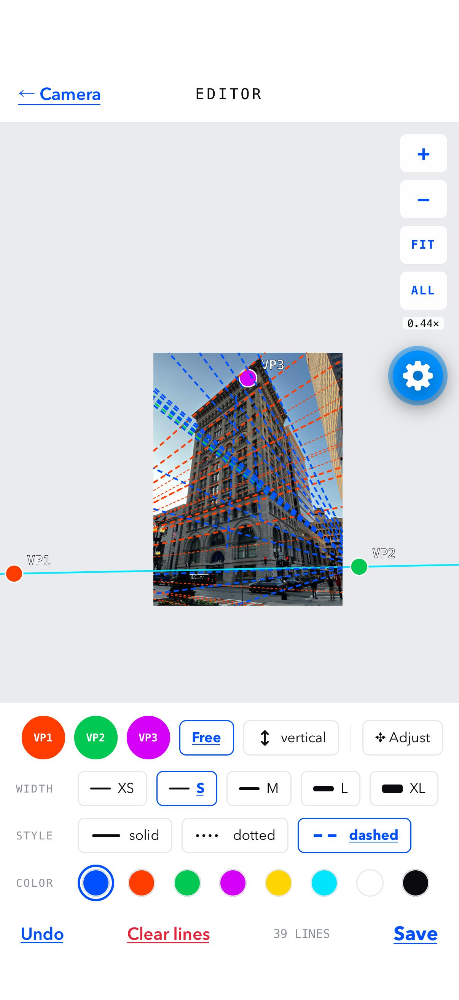
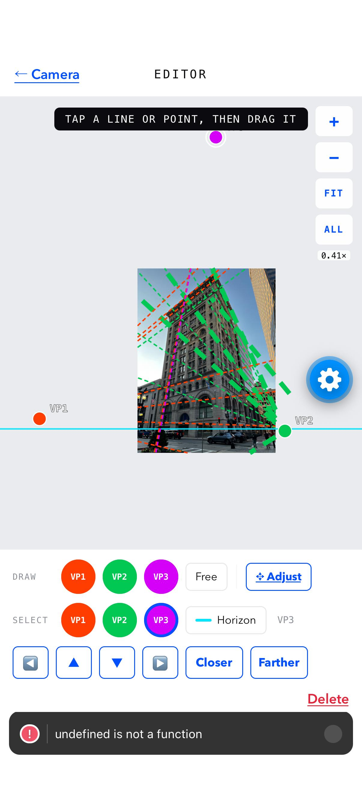

# Vanishing Point

<table align="center">
  <tr>
    <td></td>
    <td></td>
  </tr>
</table>

## What it does and why I chose it

_TODO (write this yourself, 1–2 sentences, no AI)._

## Screens

_TODO (write this yourself, no AI): what each screen does and what you can do on it: Camera, Editor, Gallery, Perspective menu, Learn._

## How to set up and run

- **Expo SDK:** 58 (Expo Router, React Native 0.88)
- **Device used:** iPhone 17 with **Expo Go** from the App Store (no simulator)
- **Requirements:** Node.js 22.13 or newer, and a free Expo account

1. Clone the repo and install dependencies:

   ```bash
   git clone https://github.com/diegosecor/Vanishing-Point-app-hw10.git
   cd Vanishing-Point-app-hw10
   npm install
   ```

2. Sign in with the same Expo account that is signed in on Expo Go on the phone:

   ```bash
   npx expo login
   ```

3. Start the development server. Tunnel mode works on any network (it reloads a bit slower):

   ```bash
   npx expo start --tunnel
   ```

4. Scan the QR code in the terminal with the iPhone Camera app. It opens the app in Expo Go.

The app asks for camera and motion permissions the first time. It needs both: the camera for the live view and motion sensors for the horizon and the level. Everything you save (photos, lines, points and settings) stays on the phone inside the app.

## Something that surprised me about mobile development

_TODO (write this yourself, no AI)._

## AI review

_TODO: after `REVIEW.md` is added, note here in a sentence any finding you decided not to fix and why._
